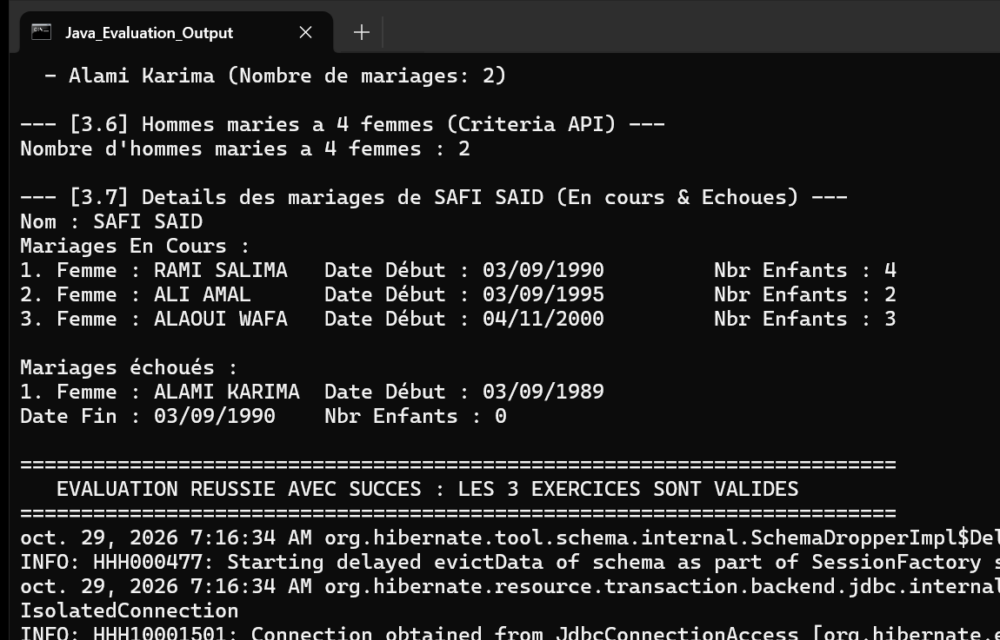

# Evaluation Pratique : Hibernate et JPA (Stock, Projets, Etat Civil)

Ce projet regroupe les 3 exercices d'evaluation pratique integrant les concepts avances d'Hibernate ORM et JPA (mapping relationnel, heritage avec JOINED, cles composites, requetes nommees @NamedQuery, requetes natives @NamedNativeQuery et API Criteria).

## Architecture et Composants

Le projet est decoupe en packages metier modulaires :

1. **Exercice 1 - Gestion de Stock (`ma.projet.classes.stock` & `ma.projet.service.stock`)** :
   - Entites : `Categorie`, `Produit`, `Commande`, `LigneCommandeProduit` avec cle composite `@EmbeddedId LigneCommandeProduitPK`.
   - Requete nommee `@NamedQuery` filtrant les produits ayant un prix > 100 DH.
   - Affichage tabulaire formate des commandes et articles.

2. **Exercice 2 - Gestion de Projets (`ma.projet.classes.projet` & `ma.projet.service.projet`)** :
   - Entites : `Employe`, `Projet`, `Tache`, `EmployeTache` avec cle composite `EmployeTachePK`.
   - Requete nommee `@NamedQuery` filtrant les taches ayant un cout > 1000 DH.
   - Suivi detaille des taches planifiees et des dates reelles de realisation.

3. **Exercice 3 - Gestion de l'Etat Civil (`ma.projet.classes.etatcivil` & `ma.projet.service.etatcivil`)** :
   - Entites : Strategie d'heritage `Personne` (classe abstraite avec `@Inheritance(strategy = InheritanceType.JOINED)`), heritee par `Homme` et `Femme`.
   - Entite associative `Mariage` liant un Homme et une Femme avec suivi du nombre d'enfants et de la date de fin.
   - Requete native `@NamedNativeQuery` calculant la somme des enfants pour une femme sur une periode.
   - Requete nommee `@NamedQuery` identifiant les femmes mariees au moins deux fois.
   - Requete Criteria API denominant les hommes maries a 4 femmes entre deux dates donnees.

4. **Infrastructure & Tests** :
   - `ma.projet.dao.IDao<T>` : Contrat generique CRUD.
   - `ma.projet.util.HibernateUtil` : Gestionnaire de sessions Hibernate.
   - `ma.projet.test.App` : Programme principal execuntant les trois volets applicatifs de maniere ordonnee.

## Resultat d'Execution

L'application a ete executee directement en ligne de commande pure Java sans logs de construction Maven.

La capture d'ecran de la console ci-dessous illustre le resultat reel de l'execution complete :

### Description de la Capture

La console presente les 3 exercices :
1. Volet Stock : Affichage du bon de commande formate (reference, prix en DH, quantite) et liste des produits filtrant sur prix > 100 DH.
2. Volet Projets : Affichage du suivi des taches realisees par projet avec dates reelles et liste des taches au prix > 1000 DH.
3. Volet Etat Civil : Affichage exhaustif des mariages en cours et echoues par individu, recherche de la femme la plus agee, calcul du total d'enfants et verification Criteria de polygamie.
